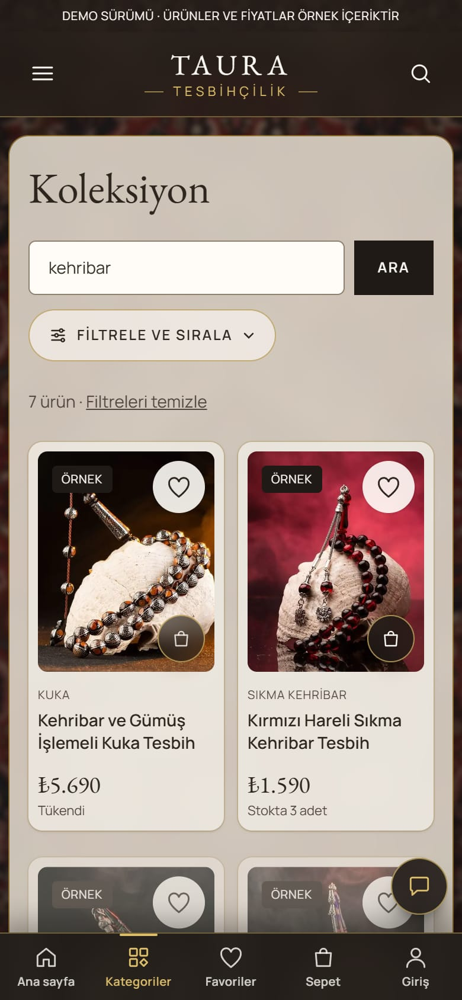

# TAURA Tesbihçilik

El işçiliği tesbih satan hayali bir mağaza için baştan sona geliştirilmiş bir e-ticaret **demo projesi**. Vitrin sayfalarından ödemeye, müşteri hesabından yönetim paneline kadar gerçek bir mağazanın ihtiyaç duyduğu akışların hepsi çalışır durumda; tasarım Türk halısı, bordo ve gold tonlarından ilham alır.

> **Demo:** Proje canlıya çıkmak için değil, gösterim amacıyla hazırlandı. Ürünler, fiyatlar ve görseller örnek içeriktir; kartla ödeme yalnızca iyzico'nun deneme (sandbox) ortamıyla çalışır, gerçek para çekilmez.

**Teknolojiler:** Next.js 16 (App Router, Server Actions) · React 19 · TypeScript · MongoDB · Tailwind CSS 4 · sharp · iyzico

## Ekran görüntüleri


| Koleksiyon ve arama | Ürün sayfası |
| --- | --- |
|  |  |

| Telefonda ana sayfa | Telefonda koleksiyon | Telefonda ürün |
| --- | --- | --- |
|  |  |  |

## Özellikler

### Mağaza

- Halı desenli zemin üzerinde saydam paneller, gold süslemeler ve yapışkan, kaydırınca incelen üst menü
- Kategoriler, kampanyalar ve en çok satanlar vitrinleri (yatay kaydırmalı ürün şeritleri)
- Yazarken açılan **canlı arama önerileri** (görsel, ad, malzeme, fiyat; klavyeyle gezilebilir)
- Koleksiyon ve kategori sayfalarında **filtreler**: malzeme, fiyat aralığı, yalnız indirimdekiler, fiyata göre sıralama
- İndirimli fiyat gösterimi (üstü çizili eski fiyat ve indirim yüzdesi)
- Karttan tek tıkla sepete ekleme, favoriler, "son baktıklarınız"
- Ürün sayfasında fareyle **yakınlaştırma**, telefonda parmakla **kaydırılan fotoğraf galerisi**
- Telefonda **alt gezinme çubuğu**, iki sütunlu ürün ızgarası ve aşağı kayınca beliren "Sepete ekle" şeridi
- Onaylı müşteri yorumları, yıldız puanları ve ana sayfada "Müşterilerimiz ne diyor" bölümü
- Tesbih rehberi, SSS, kargo ve iade, gizlilik gibi bilgi sayfaları, WhatsApp'tan soru sorma düğmesi

### Müşteri hesabı

- İsteğe bağlı üyelik: misafir olarak da sipariş verilebilir
- Giriş yapınca sepet ve favoriler hesapla eşitlenir
- Hesap alanı: **sipariş geçmişi** (durum etiketleri ve ürün görselleriyle), değerlendirmeler, kayıtlı adresler, favoriler, profil ve parola, hesabı silme
- Teslim edilen siparişlerdeki ürünlere yorum yazma (yönetici onayından sonra yayınlanır)
- Üye olmadan sipariş numarası ve e-postayla sipariş sorgulama

### Sipariş ve ödeme

- Ödeme formunda il ve ilçe listeden seçilir, telefon ve posta kodu maskeli girilir; adres kaydedilip sonra seçilebilir
- Kartla ödeme iyzico'nun barındırdığı ödeme sayfasında yapılır, kart bilgisi siteye hiç uğramaz; ödeme sonucu iyzico'dan sunucu tarafında doğrulanır
- Ödeme başlarken **stok 20 dakika ayrılır**: son ürün iki kişiye birden satılmaz, ödeme yapılmazsa stok geri döner
- **İndirim kuponları**: yüzde ya da sabit tutar, son kullanma tarihi, kullanım sınırı, en az sepet tutarı, müşteri başına tek kullanım
- Sipariş e-postaları (müşteriye "alındı" ve "kargoya verildi", yöneticiye "yeni sipariş"). Demoda e-postalar gönderilmez, yönetim panelinde okunabilir şekilde kaydedilir.

### Yönetim paneli (`/yonetim`)

- **Genel bakış:** bekleyen siparişler, yapılacaklar (onay bekleyen yorum, düşük stok), ilgilenilmesi gereken ödemeler
- **Ürünler:** taslak/yayında, kategori, eski fiyat, çoklu fotoğraf yükleme ve sıralama, otomatik EAN-13 barkod
- **Siparişler:** durum akışı (ödendi → hazırlanıyor → kargoda → teslim), kargo bilgisi, iptal ve iade, yönetici notu, müşteriye WhatsApp bağlantısı
- **Stok takibi:** düşük stok uyarıları ve stok hareketleri
- **Kampanyalar:** kupon oluşturma ve yönetme
- **Yorumlar:** onaylama ve reddetme
- **Site görünümü:** kategoriler ve vitrinler
- **Ayarlar:** iletişim bilgileri, kargo ücreti, ana sayfa görseli, yönetici parolası

### Güvenlik ve erişilebilirlik

- Her istekte yenilenen nonce'lu içerik güvenlik politikası (CSP) ve güvenlik başlıkları
- Parolalar scrypt ile saklanır; oturum anahtarlarının veritabanında yalnızca özeti tutulur; giriş, sipariş, sorgu ve yorum gibi işlemlerde hız sınırı vardır
- Fiyat, stok ve indirimler her zaman sunucuda veritabanından yeniden hesaplanır, tarayıcıdan gelen tutara güvenilmez
- Yüklenen görsellerin türü içeriğinden doğrulanır, konum ve tarih gibi gizli bilgileri silinir
- Klavyeyle gezinme, görünür odak çerçeveleri, ölçülmüş renk kontrastları, ekran okuyucu etiketleri ve "hareketi azalt" tercihine uyum
- Demo sürümü arama motorlarına kapalıdır (`noindex`)

## Çalıştırma

Gerekenler: Node.js 24 ve yerelde çalışan bir MongoDB.

```bash
npm install
npm run seed          # örnek ürünleri ve örnek görselleri hazırlar
npm run dev           # http://localhost:3000
npm run admin:create  # yönetim paneli için yönetici hesabı açar (parolayı ekranda göstermeden sorar)
```

Ayarlar ortam değişkenleriyle verilir ve proje klasöründeki `.env` dosyasına yazılır (bu dosya git'e girmez). Hepsi isteğe bağlıdır:

| Değişken | Ne işe yarar |
| --- | --- |
| `MONGODB_URI` | Veritabanı adresi (varsayılan `mongodb://127.0.0.1:27017/taura`) |
| `MEDIA_DIR` | Yüklenen görsellerin klasörü (varsayılan `media/`) |
| `SITE_URL` | Sitenin tam adresi (e-postalardaki ve ödeme dönüşündeki bağlantılar için) |
| `SITE_INDEXING` | `on` verilirse site arama motorlarına açılır |
| `PAYMENT_PROVIDER` | Boş: kartla ödeme kapalı · `fake`: yerel deneme ödeme sayfası · `iyzico`: iyzico |
| `IYZICO_API_KEY`, `IYZICO_SECRET_KEY` | iyzico anahtarları (`npm run payment:iyzico` ekranda göstermeden sorar ve yazar) |
| `IYZICO_BASE_URL` | Boş bırakılır; anahtar `sandbox-` ile başlıyorsa deneme ortamı kullanılır |
| `MAIL_TRANSPORT` | E-posta taşıyıcısı; varsayılan `log` (gönderilmez, kaydedilir) |

Diğer komutlar: `npm run admin:reset` (yönetici parolasını sıfırlar), `npm run admin:list`, `npm run payment:durum` (ödeme ayarının durumunu anahtarları göstermeden yazar), `npm run payment:kapat`.

## Proje yapısı

```
src/app/(site)/      mağaza sayfaları (ana sayfa, koleksiyon, ürün, sepet, ödeme, hesap, sipariş, bilgi sayfaları)
src/app/yonetim/     yönetim paneli
src/components/      ortak arayüz bileşenleri
src/lib/             iş kuralları: ürünler, siparişler, ödeme, stok, kupon, yorum, kimlik doğrulama
scripts/             örnek veri, yönetici hesabı ve ödeme ayarı komutları
public/images/       arka plan görseli
media/               yüklenen ürün görselleri (git'e girmez)
```
